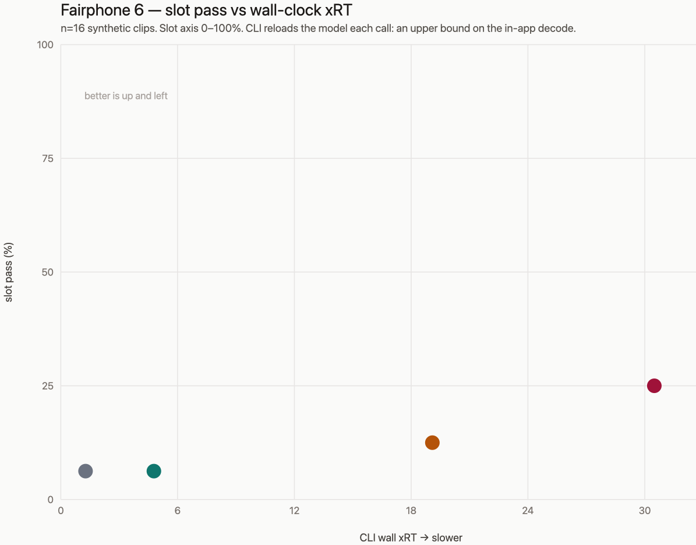

# Phone recheck — the July ranking still holds (2026-10-28)

**Device:** Fairphone 6, serial class Dimensity 7300, Android 16, arm64-v8a, CPU only.
**Question:** three months after the July bench, is `small-f16` still the daily default, or has a heavier catalog rung earned the slot?

The catalog default stays `small-f16`. Nothing in this run clears it on quality without blowing the live budget.

## What this run is, and what it is not

Same phone, same whisper.cpp **1.9.1**, same shipping march (`armv8.2-a+fp16+dotprod`, NDK 27.1, Release). Decode params match the app JNI path: greedy, `no_context=true` (the whisper.cpp default, which `jni.c` also sets), `language=auto`, 4 threads, no initial prompt. The CLI was invoked as `whisper-cli -m … -f … -l auto -t 4 -np -otxt`.

This is **not** a replay of the July matrix.

- **Voices.** July used piper, n=8. This run uses macOS `say` (Thomas for French, Samantha for English) plus ffmpeg to 16 kHz mono, **8 corpus cases × 2 voices = 16 clips**. Absolute WER and slot counts are not comparable to July. Compare models inside this run.
- **Wall clock includes a model load on every clip.** `whisper-cli` exits after each file, so each of the 16 calls pays load + encode + decode. The app loads once and keeps the context. These seconds are an **upper bound** on the in-app decode, not the rolling xRT a user feels. July's in-process numbers (small-f16 ~3.4 xRT, medium-q5_0 ~12.8 xRT with dotprod) remain the live-budget reference.
- **Thermal drift.** Absolute milliseconds move with the phone's temperature. The ordering inside this run is the signal.
- **Mic stayed closed.** The user was in a meeting. Clips are synthetic. Transcript text was scored locally and is not in this note.

Scoring is `tuparles.eval.score_case` on the raw CLI text: slot pass is the gate, WER is the trend. No desktop `pipeline.postprocess`. At n=16 a WER sd of ~0.3 still swallows a 0.03 gap. A one-case slot move is noise.

## Results

CLI wall time, Fairphone 6, 2026-10-28. Mean audio length 3.29 s.

| model | size | mean wall s | wall sd | mean xRT | slot pass | mean WER | WER sd |
|---|--:|--:|--:|--:|:--:|--:|--:|
| base-f16 | 142 MB | 4.0 | 0.47 | 1.27 | 1/16 | 0.56 | 0.33 |
| **small-f16** (default) | 466 MB | 14.9 | 2.0 | 4.78 | 1/16 | 0.55 | 0.28 |
| medium-q5_0 | 515 MB | 60.0 | 4.4 | 19.1 | 2/16 | 0.51 | 0.36 |
| large-v3-turbo-q5_0 | 547 MB | 96.2 | 9.2 | 30.5 | 4/16 | 0.35 | 0.31 |

Paired, clip by clip, against small-f16:

| comparison | clips with lower WER | mean WER delta | extra slot passes |
|---|--:|--:|--:|
| medium − small | 8/16 | −0.03 | +1 |
| turbo − small | 13/16 | −0.19 | +3 |
| small − base | 4/16 | −0.02 | 0 |

Voice split, slot pass only: every model failed all 8 English clips except turbo, which passed 2/8. French passes were 1, 1, 2, 2 for base, small, medium, turbo.

## Reading it

**Speed is hard signal.** The four means sit in bands that do not overlap (4 s, 15 s, 60 s, 96 s). Even after you subtract a model load, medium and turbo cannot fall into the daily budget. July's in-process dotprod numbers already had medium at ~13 xRT and turbo off the daily ladder. This run does not reopen that.

**small-f16 does not beat base-f16 on this corpus.** Same slot count (1/16), WER delta −0.02, and small is lower-WER on only 4 of 16 clips. That is a tie, not a demotion. July, on piper clips and the same scorer, had small clearly ahead of base (3/8 vs 1/8, WER 0.52 vs 0.61). One synthetic voice pair is not enough to retire the default. It is enough to refuse a "small is obviously better on every corpus" claim.

**medium-q5_0 buys nothing you can see.** One extra slot and a 0.03 WER dip, for four times the wall clock. Same call as July: not the daily driver.

**large-v3-turbo-q5_0 is the only quality step that clears the noise.** WER down 0.19, lower on 13/16 clips, slots 4/16 instead of 1/16, and it is the only rung that passed an English clip. It is also ~96 s of wall clock per 3 s of audio, and July already measured it at 30–44 s once loaded. That is a batch / "I can wait" rung, which is how the catalog already describes it. It does not replace the default.

## Recommendation

Leave `ModelCatalog.recommended` on `small-f16`. Keep base-f16 as the light rung, medium-q5_0 and large-v3-turbo-q5_0 as the slow rungs. No catalog edit in this change.

## Caveats worth not losing

- The CLI passes `initial_prompt` as `""` rather than NULL. `whisper_tokenize` of an empty string returns 0, so the prompt is not applied. Same practical path as the JNI NULL. Noted so the next person does not "fix" a difference that is not one.
- stderr from this CLI build did not print the internal `whisper_print_timings` lines, so load and decode could not be split. The upper-bound caveat stands until someone re-runs with timings enabled.
- English `say` (Samantha) is a harder miss than French `say` (Thomas) on every rung. A future n should include a French-accent English voice if the question is user-visible code-switch, which is what the July piper set was for.
